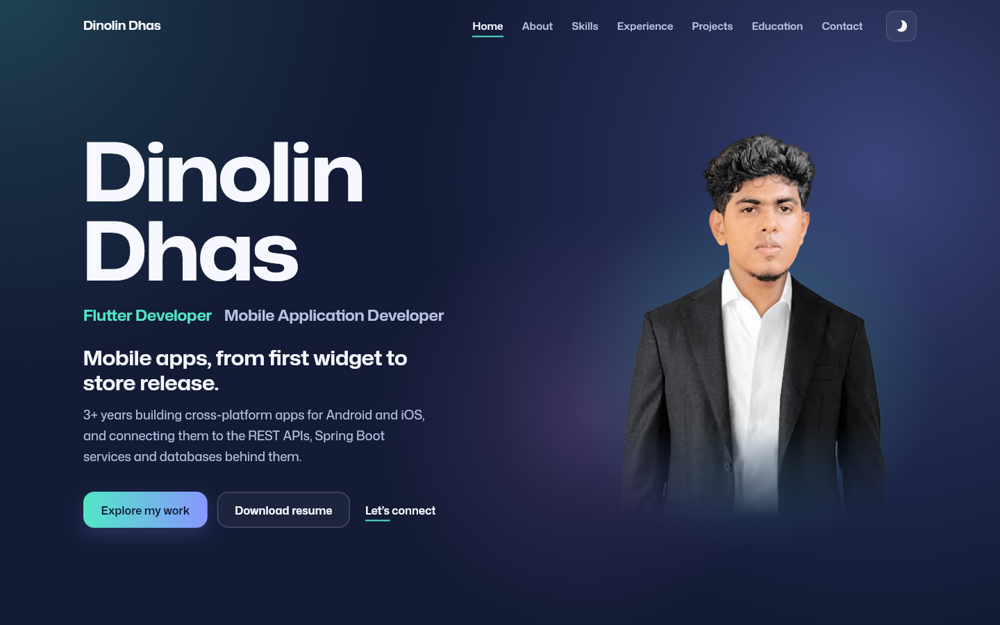
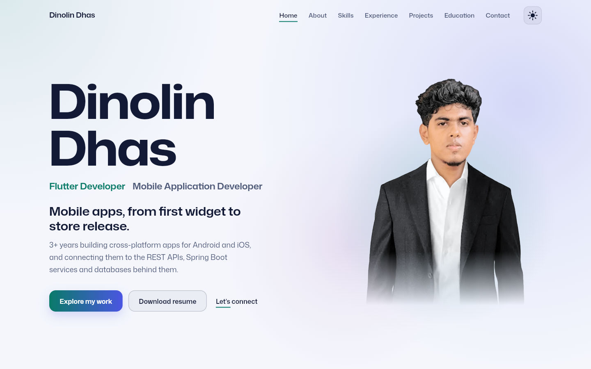
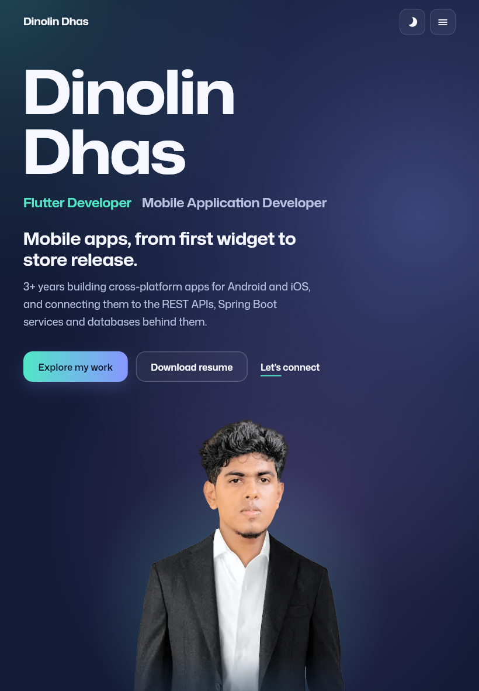
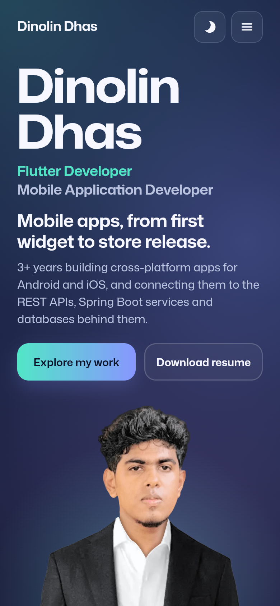
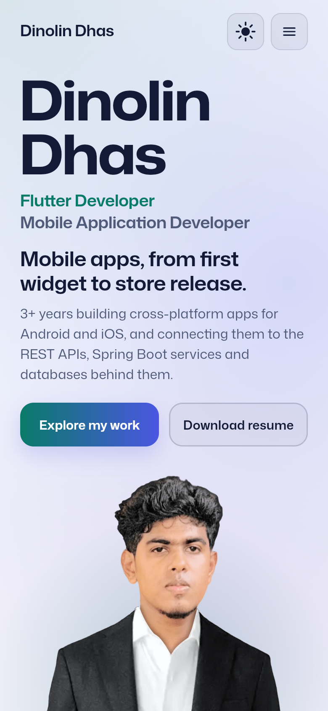

# Dinolin Dhas: portfolio

**Live site: https://dinotechdesigns.github.io/dinolin-dhas-portfolio/**

Personal portfolio of Dinolin Dhas, Flutter Developer and Mobile Application Developer, built with Flutter Web.

The site is a single responsive page covering background, skills, experience, projects, education and contact. It has a light and a dark theme, and a layer of motion that follows the visitor: the cursor, the cards and the portrait all respond to the mouse.

## Screenshots

| Dark | Light |
| --- | --- |
|  |  |

| Tablet | Phone, dark | Phone, light |
| --- | --- | --- |
|  |  |  |

## Features

- Light and dark themes: follows the system at first, remembers the visitor's choice, and opens outward from the switch
- Site-wide cursor effects: a trailing ring, a soft light behind the page, magnetic buttons, and cards that light up and tilt
- Spring physics: sections trail the scroll and bounce into place, entrances land with a small jump, and the portrait sways after the mouse
- Staggered hero entrance, scroll reveals, an animated timeline and a skills widget tree
- Section navigation with a gliding mouse wheel, a veil transition for long jumps, a progress line and an active-section indicator, plus a full-screen menu on small screens
- Project details with real app artwork, and an original illustration where no screenshots exist
- Email, LinkedIn and WhatsApp contact, and a resume download
- Keyboard navigation, visible focus, Flutter's opt-in screen-reader mode and support for reduced motion
- Page metadata, structured data, a social preview image and readable content without JavaScript
- No third-party requests while the page loads: fonts and the rendering engine are self-hosted

## Built with

- Flutter (tested with 3.44) and Dart
- [`url_launcher`](https://pub.dev/packages/url_launcher) for external links
- [`web`](https://pub.dev/packages/web) for the resume download, the saved theme and the reduced-motion preference

Animations use Flutter's own animation system.

## Project structure

```
lib/
  main.dart
  app/            App widget, theme, configuration and content
  core/           Animations, cursor, scrolling, responsive helpers, shared widgets, browser access
  features/       shell, home, about, skills, experience, projects, education, contact
assets/           Images, fonts and the resume
test/             Layout and interaction tests from 320 to 1920 px
web/              index.html, icons, manifest and social preview
```

## Run locally

Requires the [Flutter SDK](https://docs.flutter.dev/get-started/install).

```bash
git clone https://github.com/DinotechDesigns/dinolin-dhas-portfolio.git
cd dinolin-dhas-portfolio
flutter pub get
flutter run -d chrome
```

## Check and build

```bash
flutter analyze
flutter test
flutter build web --release --no-web-resources-cdn
```

The site is written to `build/web`. To preview that build, serve the folder with any static server, for example `npx serve build/web`. Opening `index.html` directly from disk will not work.

## Configure

| What | Where |
| --- | --- |
| WhatsApp number | `whatsAppNumber` in `lib/app/constants/app_constants.dart`, digits only with country code |
| GitHub username | `gitHubUsername` in the same file; the GitHub button is hidden while it is empty |
| Resume | Add `assets/resume/dinolin-dhas-resume.pdf` and rebuild |
| Project links | `storeUrl` on a project in `lib/app/constants/portfolio_content.dart` |
| Colours of both themes | `lib/app/theme/app_palette.dart` |
| Text, jobs, skills | `lib/app/constants/portfolio_content.dart` |
| Site address for link previews | `canonical`, `og:url`, `og:image` and `twitter:image` in `web/index.html` |

Until a WhatsApp number or resume is added, those buttons say so and offer email instead.

## Deploy

The output is static and works on any static host.

**GitHub Pages**

```bash
flutter build web --release --no-web-resources-cdn --base-href /dinolin-dhas-portfolio/
```

Publish the contents of `build/web` to a `gh-pages` branch, add an empty `.nojekyll` file beside `index.html`, then choose that branch under Settings, Pages. For a site served from a domain root, leave out `--base-href`.

**Netlify, Vercel or Cloudflare Pages**

Build locally and upload `build/web` as the site folder.

**Firebase Hosting**

```bash
firebase init hosting   # public directory: build/web
firebase deploy --only hosting
```

## Credits

[Mona Sans](https://github.com/github/mona-sans) is licensed under the SIL Open Font License; see `assets/fonts/OFL.txt`. Brand glyphs are a subset of [Font Awesome Brands](https://fontawesome.com), also under the SIL Open Font License. App icons and screenshots belong to their respective owners.
